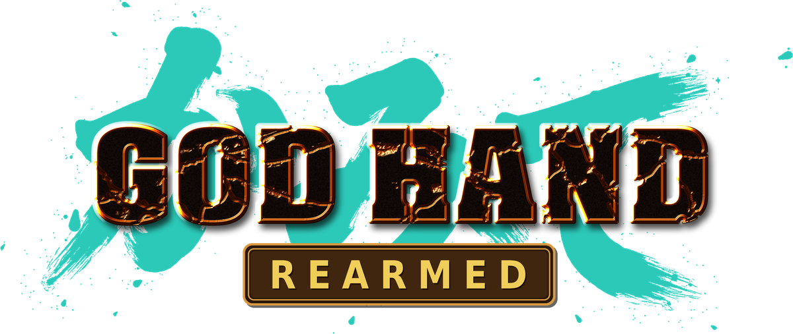

# God Hand: Rearmed

**God Hand: Rearmed** is an unofficial, fan-made native PC port of **God Hand** (PlayStation 2, 2006), built by static
recompilation: the game's own code rebuilt as a Windows program, with PCSX2's hardware renderer for the graphics. Its
codename, Kamite, is the name the code and its folders use.

> [!WARNING]
> **Under construction.** The game plays from start to credits, but the port is still being tested. Expect bugs.

> **No game files are included.** You need your own disc image of the game (USA, serial SLUS-21503; see
> [DISC_HASHES.md](DISC_HASHES.md)). Building and playing: [docs/BUILDING.md](docs/BUILDING.md).

## Features

- **Native on Windows 10/11:** the PS2 program recompiled to C++, the PS2 hardware reimplemented in `runtime/`.
- **PCSX2's hardware renderer** (Direct3D 11) at 1x to 8x the PS2's resolution, with the game's own PCSX2 fixes,
  precise depth (no z-fighting on distant scenery) and an option to turn the depth of field off.
- **60 FPS mode**, with timers, the roulette, menus and prompts kept at the PS2's speed.
- **Any aspect ratio** (16:9, 21:9, 32:9...), the HUD at the screen edges or where the PS2 had it, menus in the PS2's
  proportions or stretched.
- **Camera options:** field of view, distance and tilt (live in the F2 menu, with presets), fights framed as on the
  PS2, and enemies whose sense of "in front of Gene" widens with the picture.
- **HD texture packs** in PCSX2's format, their alpha kept to the game's own levels so nothing turns see-through.
- **A launcher:** install (pick and check your disc image), play, every option in one place, and Add to Steam (a
  non-Steam library entry with art).
- **Quality of life:** Click-Stick Dash, d-pad scrolling in the God Reel, a double-time roulette timer, Hard unlocked from the
  start, music mute, the blur effects at full resolution.
- **Controls:** keyboard, mouse and controllers, rebindable in game (F1). Button prompts show the keys and buttons you
  use at full resolution (Xbox 360, Steam Deck, Switch or keyboard art, picked from your controller or set in the
  launcher; PlayStation pads keep the game's own). Menu controls Western (south confirms, east cancels; the roulette too) by default, or Japanese or
  Classic in the launcher; the moves keep their buttons.
- **Playable characters:** a character system that swaps the player model at the disc level, with an example mod
  (Xavier from *Xavier: Renegade Angel*).
- **Diagnostics for developers:** crash and hang logs with function names, PC sampler, call profiler, frame, RAM and
  GS dumps.

## Being worked on

- **Modern controls:** a free camera on the right stick or the mouse, camera-relative movement, the radar following
  the view; pressing the right stick switches to brawl mode (classic controls) and back.
- **See Through** (experimental): walls between the camera and Gene dissolve round him; walls next to the camera
  no longer vanish.
- **Playing the whole game through** on the port: stages 4 to 8, the ending, the Coliseum and the extras.
- **Characters:** Xavier in cutscenes, hair physics, fewer clipping animations; more characters the same way.
- **Movesets:** moveset swaps and profiles, move-property tweaks (from the game's motion and event data).
- **Later:** Vulkan, Linux and Android.

See [CHANGELOG.md](CHANGELOG.md) for what changed and when.

## Credits

- [LasVola/godhand-recomp](https://github.com/LasVola/godhand-recomp): the recompilation God Hand: Rearmed started from (the
  running game, the SNR2 overlay loader, the button prompts, the first fixes), built on
  [PS2Recomp](https://github.com/ran-j/PS2Recomp) by ran-j and contributors, the
  [sotc-port runtime fork](https://github.com/LightVelox/PS2Recomp) by LightVelox, and the
  [Urban Reign port](https://github.com/thiagordsfx/urban-reign-recomp) by thiagordsfx (runtime, VU1 compiler, sound,
  PCSX2 graphics bridge).
- [LucasPicoli/god-hand-decomp](https://github.com/LucasPicoli/god-hand-decomp) and its contributors: function names,
  boundaries and structures.
- [PCSX2](https://github.com/PCSX2/pcsx2): the hardware renderer in `thirdparty/` and the game's GameIndex fixes.
- The "60 Fps" and "Widescreen 16:9" PCSX2 patches for SLUS-21503 (Puggsy and others): the basis of the 60 FPS mode
  and the aspect-ratio support.
- [anasrar/chihuahua](https://github.com/anasrar/chihuahua) (MIT): file-format knowledge and the motion reader
  `tools/models/mot.py` is ported from.
- [akitotheanimator/God-Hand-Tools](https://github.com/akitotheanimator/God-Hand-Tools) (with CarLoiD, Kerilk and Roni
  Evil): model, motion and motion-event format knowledge.
- Nicolae "Xelu" Berbece (Those Awesome Guys): [Xelu's free controller and keyboard prompts](https://opengameart.org/content/free-keyboard-and-controllers-prompts-pack)
  (CC0), the button prompt art in `resources/prompts/xelu` (but the Nintendo L / R shoulders, the port's own).
- [Quaternius](https://quaternius.com): the Universal Animation Library 1 and 2 (CC0), the NPC poses' rail lean, dance and
  folded-arms idle.
- [Denys Almaral](https://denysalmaral.com): the Free Animation Pack for City People, two of the NPC poses' idles.
- Harold Lohner ([haroldsfonts.com](http://www.haroldsfonts.com)): the Dominican font of the launcher's splash text.
- The Archivo Narrow Project Authors: [Archivo Narrow](https://github.com/Omnibus-Type/ArchivoNarrow) (OFL-1.1), the
  OPTIONS screen's labels (a SemiBold instance in `resources/fonts`).
- Bitstream and the DejaVu fonts team: [DejaVu Sans](https://dejavu-fonts.github.io) (Bitstream Vera licence), the
  OPTIONS screen's help text.
- [Ace Combat 5 static recompilation](https://github.com/sal063/Ace-Combat-5-Static-recompilation): the movie decoder
  (Apache-2.0).
- Xavier and *Xavier: Renegade Angel* belong to Adult Swim. The Xavier mod is a fan-made example of the character
  system and is not affiliated with or endorsed by Adult Swim.
- God Hand: Rearmed is directed, play-tested and written by K, built with AI assistance (Claude by Anthropic), with ideas and
  testing from his friends.

## Legal

The code is GPL-3.0 ([LICENSE](LICENSE)), like PS2Recomp. Third-party licenses are in `docs/licenses/` and the
`thirdparty/` folders. **No game data is included.** God Hand is a trademark of Capcom. This project is not affiliated
with or endorsed by Capcom or Clover Studio.
